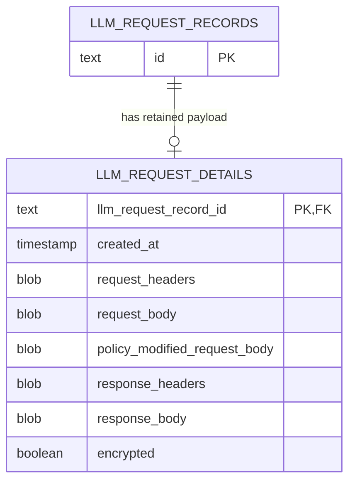

# 2026-08-14: Unify LLM audit and token usage storage

- **Authors:** @calvinmclean
- **Created:** 2026-08-14

## Summary

Replace overlapping audit and token-activity records with a durable
`llm_request_records` row and optional `llm_request_details` payload row. Delete
details under LLM audit retention while retaining metadata and usage. Keep the
Token Usage UI and interfaces unchanged and add spend to audit results. Open the
door for future correlation and analysis.

## Related issues

- [obot-platform/obot#7515](https://github.com/obot-platform/obot/issues/7515) —
  report per-request and per-session spend in LLM audit logs and consider
  consolidating the duplicate persistence paths.

## Related ODPs

None.

## Problem and motivation

Each completed LLM request currently produces overlapping records:

- `llm_audit_logs` contains request metadata, request and response payloads, and
  only input/output token counts; and
- `run_token_activities` contains attribution plus normalized token buckets and
  spend used by the Token Usage UI and daily token-limit enforcement.

They lack a shared ID. Token usage is synchronous and retained indefinitely;
audit writes are buffered, droppable, and optional, and their rows are deleted
after 90 days by default. Therefore the audit API lacks recorded spend, while
its current rows can be absent even when token activity exists.

## Goals

- Store one authoritative usage record per new LLM request.
- Preserve Token Usage UI and interfaces; continue deriving daily limits from
  retained usage.
- Add normalized tokens and spend to audit rows.
- Retain most usage details while expiring large payloads.
- Enable future cost correlation with coding-agent session IDs without the
  payload retention limit.

## Non-goals

- Redesigning Token Usage UI or response types.
- Retaining LLM payloads beyond configured audit retention.
- Joining historical audit and token rows; no reliable correlation key exists.
- Correlating total cost with an agent session; that is follow-up work.

## Context and constraints

- Current LLM audit storage uses a bounded, non-blocking buffer, batch flushes,
  best-effort persistence, and shutdown draining.
- Disabling LLM audit does not disable usage storage or daily-limit accounting.
- New details must preserve current encryption behavior.

## Proposed design

### Data model

Treat an LLM request as a durable record with an optional retained detail:

`usage_recorded` separates accounted requests, including valid zero usage, from
events lacking usage. `audit_visible` hides minimal rows created when auditing
is disabled or when importing legacy usage.

Details use the parent ID as primary and cascading foreign key. They move the
five header/body columns and `encrypted` marker from `llm_audit_logs`.
`created_at` is copied from the parent and remains immutable, allowing retention
cleanup without a join.

### Persistence and failure behavior

Reuse the current LLM audit pattern: bounded non-blocking buffer,
periodic or size-based batch flush, best-effort persistence, and shutdown drain.

Disabling audit omits audit-only metadata and details but still enqueues a
minimal usage row hidden from audit results. A full buffer or failed batch can
drop usage; Token Usage and daily limits may lag or undercount during sustained
persistence failure.

### Retention

Retention process itself is unchanged, but it now deletes from `llm_request_details`
instead. This allows us to clean up the bulk of the data while keeping other useful
metadata about requests.

### HTTP interfaces and UI

Keep these existing interfaces and response types:

- `GET /api/token-usage`
- `GET /api/total-token-usage`
- `GET /api/users/{user_id}/token-usage`
- `GET /api/users/{user_id}/total-token-usage`
- `GET /api/users/{user_id}/remaining-token-usage`

These interfaces project existing `TokenUsage` responses from the new table.

### Indexes

Recreate useful audit indexes and add:

- `llm_request_details(created_at)` for retention cleanup;
- `(usage_recorded, created_at)` for system time-series reads;
- `(user_id, usage_recorded, created_at)` for per-user totals and limits; and
- `(client_session_id, usage_recorded, created_at)` for session totals.

Validate exact order and covering indexes with PostgreSQL `EXPLAIN` and
representative SQLite data.

## Alternatives considered

### Split the existing audit table in place

Add usage fields to `llm_audit_logs`, create a child detail table, backfill the
encrypted payload columns, dual-write both layouts during a compatibility
release, and later remove the payload columns and `run_token_activities`.

This avoids union reads but needs backfills and destructive migration. SQLite
may rebuild tables; PostgreSQL may create heavy writes and dead tuples. Clearing
old columns also weakens rollback.

### Null payload columns in the existing table

Retention could set five payload columns to `NULL`, minimizing schema change and
avoiding joins. Repeated large-row updates, encryption coordination, PostgreSQL
vacuum pressure, and limited SQLite space reclamation make this the fallback.

### Make the Token Usage UI call the audit-log interface

This removes a route but couples unpaginated analytics to paginated audit
permissions and filters; session totals spanning pages would be wrong.

### Keep both write paths and join at read time

No correlation key permits a reliable join, and continued duplicate writes
preserve inconsistent failure behavior.

### Store payloads outside the database

Object storage reduces DB size but adds a required dependency, orphan cleanup,
and separate encryption, authorization, and availability concerns.

## Trade-offs

- One buffered write removes duplicate accounting and partial parent/detail
  records, but makes usage eventually consistent and best-effort.
- Details add a one-to-zero-or-one join; list reads can use `EXISTS`.
- Child deletion simplifies retention; new tables simplify rollback but require
  temporary cross-generation reads.
- Durable metadata and indexes consume more space and retain more potentially
  sensitive information than token activity does today.

## Risks and open questions

- **Retention and privacy:** Security and product must decide which metadata—IP,
  user agent, session, path, error—may persist indefinitely. Size this indexed
  data at representative volume.
- **Session identity:** Client session IDs are not globally unique. Product must
  choose whether grouping also includes user and API key.
- **Buffered accounting:** Full buffers and failed batches can drop usage and
  weaken daily-limit enforcement. Buffer pressure, dropped entries, flush lag,
  and batch failures need metrics and alerts.
- **Cutover:** Every replica must support dual reads before a DB-backed setting
  switches writers. Time-based or per-process cutovers risk gaps or duplicates.
  Pagination, counts, filters, exports, and details must span both generations.
- **Rollback:** Compatibility binaries see both generations; older binaries
  temporarily hide new-table records without deleting them.
- **Legacy retirement:** Token history outlives audit payloads and must remain
  readable or be losslessly imported. With retention cleanup disabled, old
  audit storage also cannot age out automatically.
- **Visibility:** Audit-disabled usage rows must remain hidden. Expired details
  must be explicit in UI and exports.
- **Precision:** Preserve current `float64` spend; fixed-point is separate work.

## Rollout and migration

Use a new-table cutover without dual writes; each request belongs to one storage
generation, making `UNION ALL` safe.

1. **Expand:** Create `llm_request_records` and `llm_request_details`, including
   their foreign key and indexes. Leave `llm_audit_logs` and
   `run_token_activities` unchanged.
2. **Compatibility release:** While writers remain old, deploy readers combining
   both generations for audit, export, usage, and limit queries.
3. **Cut over:** After all replicas upgrade, switch a shared DB setting. Each
   request pins it before proxying so usage and delayed details cannot split
   across generations. New requests write only new tables.
4. **Reconcile:** Compare daily counts and all token/spend buckets by user;
   verify audit counts, exports, authorization, and retention.
5. **Retire old audit storage:** Let existing cleanup empty `llm_audit_logs`,
   then remove its read path and table. No payload migration is needed.
6. **Retire old token storage separately:** Keep `run_token_activities`
   read-only or copy it into deterministic, audit-hidden legacy usage rows.
   Verify counts and sums; never heuristically match old audit events.

Rollback switches the setting back on a compatibility binary; both generations
remain visible. Drop nothing until data expires or migrates and rollback closes.

## Testing and validation

- SQLite/PostgreSQL migration tests with encrypted legacy data, mixed
  generations, cutover, restart, and rollback.
- Persistence tests for batching, retries, shutdown drain, full buffers,
  missing/unpriced usage, disabled audit, and atomic parent/detail failure.
- Retention and encryption tests: details expire, usage survives, authorization
  holds, and the expected data context encrypts/decrypts details.
- Legacy parity and mixed-version tests for usage, limits, pagination, counts,
  sorting, filters, details, and exports without gaps or duplicates.
- Audit tests for spend and expired details.
- Representative query plans/timings plus rollout reconciliation of daily
  counts and every token/spend bucket by user.

## References

- [Current LLM audit record](https://github.com/obot-platform/obot/blob/main/pkg/gateway/types/llmauditlog.go)
- [Current token activity and normalized usage records](https://github.com/obot-platform/obot/blob/main/pkg/gateway/types/activity.go)
- [Current token usage queries](https://github.com/obot-platform/obot/blob/main/pkg/gateway/client/tokenactivity.go)
- [Current LLM audit persistence and retention](https://github.com/obot-platform/obot/blob/main/pkg/gateway/client/llmauditlog.go)
- [Current LLM response completion writes](https://github.com/obot-platform/obot/blob/main/pkg/gateway/server/llmproxy.go)
